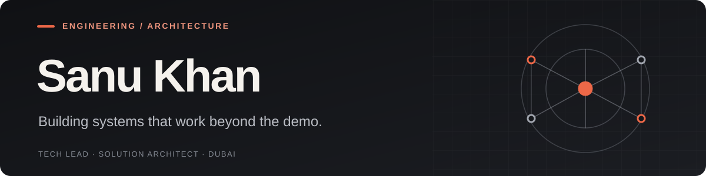

  

**Tech Lead · Solution Architect · Full-Stack Engineer**  
Dubai, UAE · 13+ years in software engineering

I turn complex business problems into maintainable software — from distributed platforms and enterprise integrations to AI-driven products. I care about clean boundaries, resilient systems, and shipping work that lasts.

[Portfolio](https://www.sanukhan.dev/) · [LinkedIn](https://www.linkedin.com/in/sanukhandev/) · [Writing](https://dev.to/sanukhandev) · [Email](mailto:hello@sanukhan.dev)

### Selected projects

| Project | What it explores |
| --- | --- |
| **[Agentic RAG AI](https://github.com/sanukhandev/agentic-rag-ai)** | Multi-tenant, privacy-aware RAG assistants with grounded chat, admin tooling, pgvector, and controlled n8n workflows. *MVP in development.* |
| **[Airport Commerce](https://github.com/sanukhandev/airport-commerce)** | Headless commerce architecture with Next.js, WordPress/WooCommerce, and secure service boundaries. |
| **[Frame Theory Studio](https://github.com/sanukhandev/frame-theory-ai-studio)** | Offline-first creative editor exploring reversible AI-assisted video, image, and color workflows. *In development.* |
| **[sanukhan.dev](https://github.com/sanukhandev/sanukhandev.github.io)** | My engineering portfolio, project case studies, and technical writing. [Visit the site ↗](https://www.sanukhan.dev/) |

### What I work with

**Architecture & platforms** · API design, integrations, multi-tenancy, cloud systems, automation  
**Engineering** · TypeScript, JavaScript, Python, PHP, React, Next.js, Angular, Node.js  
**Infrastructure & data** · Azure, Docker, PostgreSQL, Redis, WordPress/WooCommerce, Microsoft 365

### GitHub activity

Public contribution data is only part of the picture; much of my enterprise engineering work is in private repositories. The activity image is provided by a third-party service.

### Notes from the field

I write about architecture, pragmatic code quality, AI systems, and the trade-offs behind production software.

[Read my articles on DEV.to →](https://dev.to/sanukhandev) · [Explore my portfolio →](https://www.sanukhan.dev/)

---

Build for change. Design for people. Keep the system understandable.
